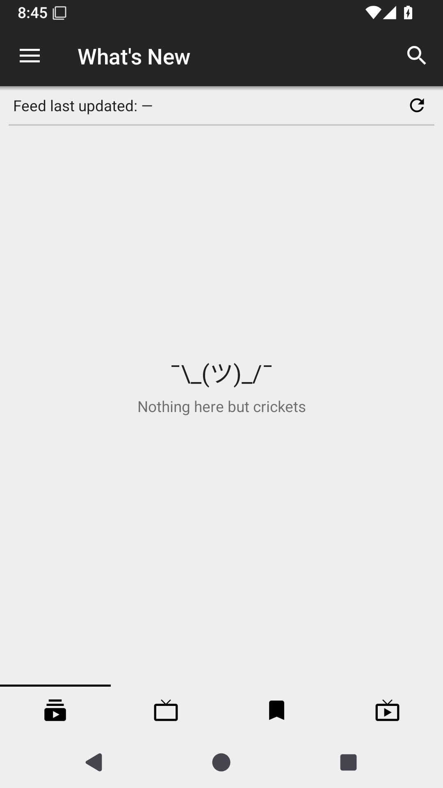
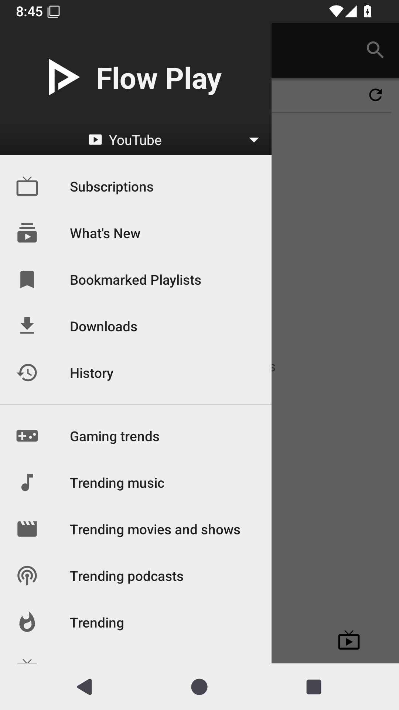

# Flow Play

**Your videos, music and subscriptions — without the clutter.**

Flow Play is a free, open-source Android app for watching YouTube videos and listening to music. It is made for people who want a simpler home screen, more control over playback, and an easier way to listen in the car.

No YouTube or Google account is needed to watch, search, or follow channels in the app. Flow Play builds on the open-source work of NewPipe, but it has its own direction and features.

**[Download Flow Play](https://github.com/userdc-dev/FlowPlay/releases) · [See the Home + Android Auto 360p build](https://github.com/userdc-dev/FlowPlay/releases/tag/flow-play-home-360p-auto-0.29.1) · [Report a problem or suggest an idea](https://github.com/userdc-dev/FlowPlay/issues)**

## What makes Flow Play different?

- **Less clutter.** Find the videos and channels you actually care about instead of wading through extra sections.
- **Watch or just listen.** Play videos normally, use background playback, or choose audio-only listening when supported by your build.
- **Make playback yours.** Adjust playback speed and video quality, manage what plays next, and save videos or playlists.
- **Follow channels without signing in.** Keep your subscriptions in the app, and import them when moving from another supported app or backup.
- **Save data.** Some builds offer mobile-data-friendly defaults so video doesn't use more data than you intended.
- **Take your music into the car.** Experimental Android Auto support focuses on audio, playlists, browsing and hands-free listening.

We care more about a reliable, easy-to-use app than filling it with settings and buttons.

## On your phone

The **Home + Android Auto 360p** build has a simpler four-tab home screen:

1. **What's New** — recent videos from channels you follow.
2. **Subscriptions** — your channels in one place.
3. **Bookmarked Playlists** — playlists you've saved for later.
4. **Live** — find live content when you want it.

That build also uses **360p as the default on mobile data** to help save data. You can still choose another quality where playback supports it.

Other experimental Flow Play releases may have different layouts or features. Check the notes for the specific download you choose.

## In your car with Android Auto

Flow Play is also being developed for **listening while driving**, without needing to switch to a different music app.

Depending on the build and your car's Android Auto support, you can:

- Browse music, playlists and suggestions based on what you've listened to recently.
- Search by voice, or use car-screen search when the car permits it.
- Save tracks to **Car Saves** and open shortcuts to existing playlists.
- Use like/dislike and playback controls where your car shows them.
- Keep listening with the car display focused on audio.

**Important:** Android Auto in Flow Play is for **audio, not watching video on the car screen**. Some controls depend on your car, and physical-head-unit testing is still ongoing.

## Download and install

**[See all Flow Play downloads](https://github.com/userdc-dev/FlowPlay/releases)**

Looking for the specific 360p phone and Android Auto build?

**[Download Flow_Play_Home_360p_Auto_0.29.1.apk](https://github.com/userdc-dev/FlowPlay/releases/download/flow-play-home-360p-auto-0.29.1/Flow_Play_Home_360p_Auto_0.29.1.apk)**

To install it:

1. Open the download link on your Android phone.
2. Download the APK and open it.
3. If Android asks, allow your browser or file manager to install apps.
4. Open Flow Play and set it up the way you like.

The **FlowPlay v2** releases also explore improved audio-only listening, queue recovery, playlist checks and playback feedback. You can find those on the same [Releases page](https://github.com/userdc-dev/FlowPlay/releases).

**Before switching builds:** Back up your subscriptions, history and playlists using the app's backup/export options where available. Experimental releases may use different app identities or signing keys, so they may not always install as an update over an earlier version. Don't uninstall an older copy until you've saved anything important.

Flow Play downloads are provided through **this repository's GitHub Releases**, not through NewPipe's download page or F-Droid listing.

## Screenshots

These screenshots were taken from the **published Flow Play Home + Android Auto 360p APK** running in an Android emulator. They are real captures, not mock-ups or old NewPipe promotional pictures.

| Flow Play home | Navigation menu |
|:--:|:--:|
|  |  |

[See the original screenshots](docs/screenshots). The look may vary between builds and Android versions. Android Auto car-screen screenshots are not included yet.

## What we're improving next

Flow Play is still a work in progress. Our focus is:

- Fewer playback failures, smoother background listening and better recovery after interruptions.
- A tidier, darker interface that puts subscriptions and playlists first.
- Better queues, related recommendations and continuous Shorts playback.
- Easier downloads, updates, backup and restore.
- More useful Android Auto browsing and controls, subject to what the car allows.

These are **goals**, not a promise that every feature is already finished in every release.

## Found a problem?

Please [open a GitHub issue](https://github.com/userdc-dev/FlowPlay/issues) and tell us which APK you installed, your Android version, what you tried, and what happened. A real screenshot is especially helpful for layout problems.

## Credits and license

Flow Play is an **independent, open-source project built on [NewPipe](https://github.com/TeamNewPipe/NewPipe)**. Thanks to the NewPipe developers and other open-source contributors whose work makes this possible.

Flow Play is not an official YouTube, Google, Android Auto or NewPipe app, and is not endorsed by those projects.

The source is shared under the [GNU General Public License v3 or later](LICENSE).
