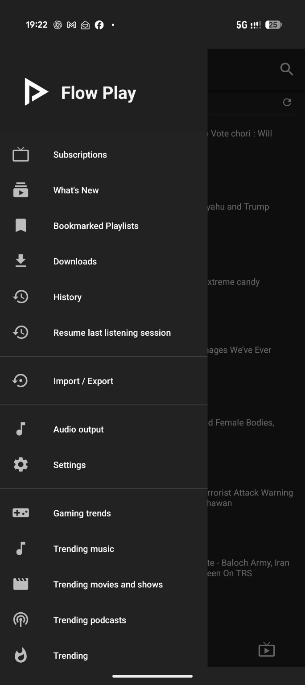
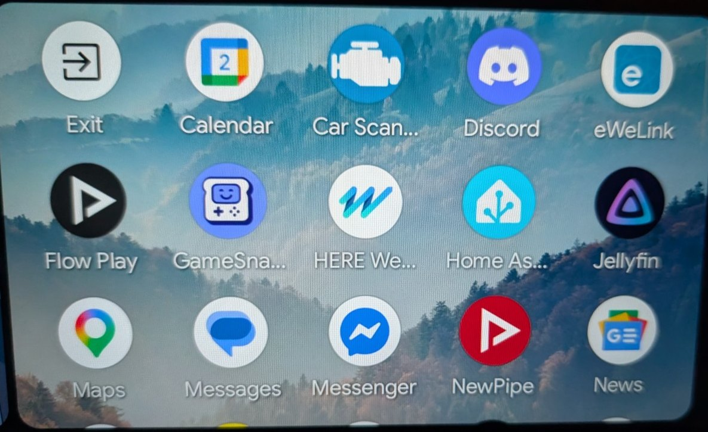
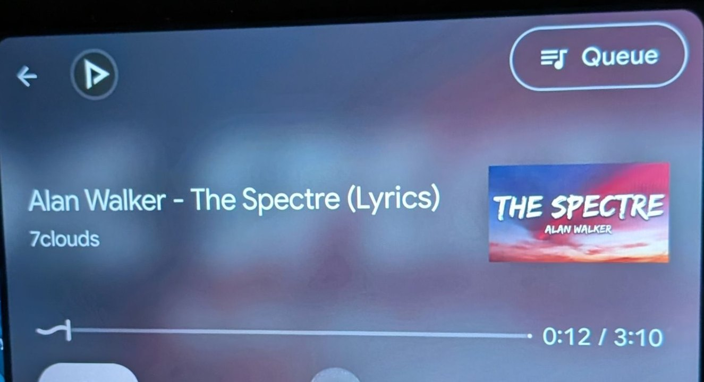
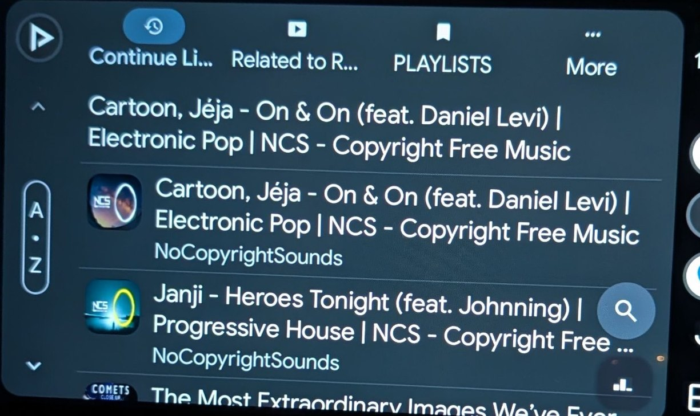
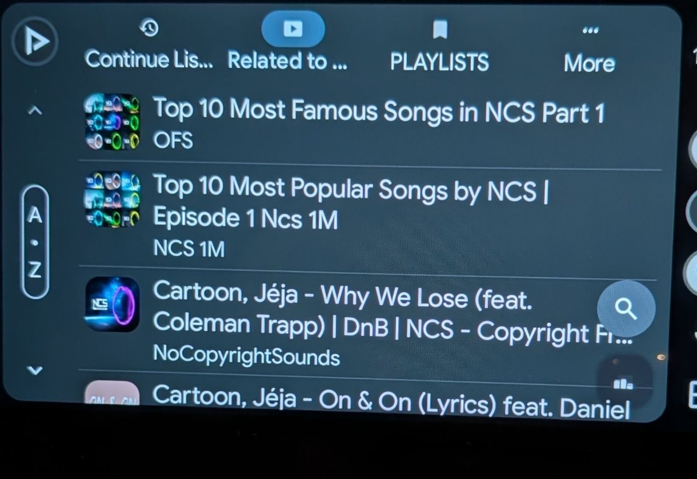

# Flow Play

**Watch what you like. Listen wherever you go. Without the clutter.**

Flow Play is an independent, open-source Android app for watching YouTube videos, listening to music, following channels and taking your listening into the car with Android Auto. No Google account is needed to watch videos or follow channels.

[**Download the latest Flow Play APK**](https://github.com/userdc-dev/FlowPlay/releases/latest) · [Report a problem](https://github.com/userdc-dev/FlowPlay/issues) · [See the source code](https://github.com/userdc-dev/FlowPlay)

## What you can do

- **Keep things simple.** Start from What's New, Subscriptions, Bookmarked Playlists or Live. Extra discovery sections sit at the bottom of the menu.
- **Watch or just listen.** Switch between video, background audio and a popup player. Where possible, background playback downloads just the audio stream.
- **Build your own listening queue.** Choose what plays next, browse related tracks and keep listening when one song finishes.
- **Tell Flow Play what you like.** Use 👍 to favour similar videos or music, and 👎 to avoid a particular item and skip to the next available track. This feedback stays in Flow Play; it is *not* a YouTube account like or dislike.
- **Keep your subscriptions without signing in.** Bring in subscriptions using supported imports, and back up your playlists, history and app settings.
- **Listen in the car.** Android Auto includes Continue Listening, related tracks, saved playlists, a queue, and playback controls. Exact buttons and layouts depend on your vehicle.
- **Save things for offline use.** Download video or audio where supported and choose audio-first download defaults.
- **Pick up where you left off.** Resume a saved listening session after an interruption or restart.

Flow Play is built around dependable playback and a clean dark interface. Some features require a network connection; YouTube service changes can sometimes interrupt playback.

## Real Flow Play screenshots

These are **real Flow Play captures**, not NewPipe promotional images. The Android Auto gallery below contains photos supplied from an actual car display.

### On your Android phone

| Home | Side menu |
|:--:|:--:|
|  |  |

### Latest phone menu

The side menu includes a direct **Import / Export** shortcut for backup and restore.

### On Android Auto

| App launcher | Now Playing |
|:--:|:--:|
|  |  |

| Continue Listening | Related tracks |
|:--:|:--:|
|  |  |

[More real Android Auto browsing](docs/screenshots/08-flow-play-android-auto-tracks.jpg).

*These are actual Flow Play screenshots and photographed Android Auto displays, not promotional mockups. The car-display photos were cropped to keep the app interface in focus.*

## Install and update

1. Open the [latest Flow Play release](https://github.com/userdc-dev/FlowPlay/releases/latest) on your Android phone and download its APK.
2. Open the file and follow Android's installation instructions. Google Play Protect may offer to scan a sideloaded app; review the result.
3. Use **Import / Export** from Flow Play's side menu to back up or restore your playlists, subscriptions, history and settings.

**About updates:** Flow Play v2.10 and newer releases use a permanent signing certificate and a stable Android package name. Once you've installed a release signed with that certificate, newer releases using the same key should install over it without losing your data.

If your previous Flow Play copy was signed with an earlier temporary key (for example v2.8 or older), Android may require a **one-time backup, uninstall, reinstall and restore**. Keep the exported backup outside the app before uninstalling. [Read the signing and update guide](.github/FLOWPLAY_SIGNING.md).

Android Auto is for **listening**, not watching video on the car screen. It should only be operated when safe; use voice or steering-wheel controls while driving.

## What's next?

The focus is smooth background playback, a useful Up Next queue, more reliable Android Auto browsing, less mobile data use and straightforward updates. Suggestions and bug reports are welcome in [GitHub Issues](https://github.com/userdc-dev/FlowPlay/issues).

## Credits and license

Flow Play is an independent project built on the open-source work of [NewPipe](https://github.com/TeamNewPipe/NewPipe). Many underlying features and components come from NewPipe and its contributors. Flow Play is not affiliated with or endorsed by YouTube, Google, Android Auto or NewPipe.

The project is distributed under the [GNU GPL v3 or later](LICENSE).
